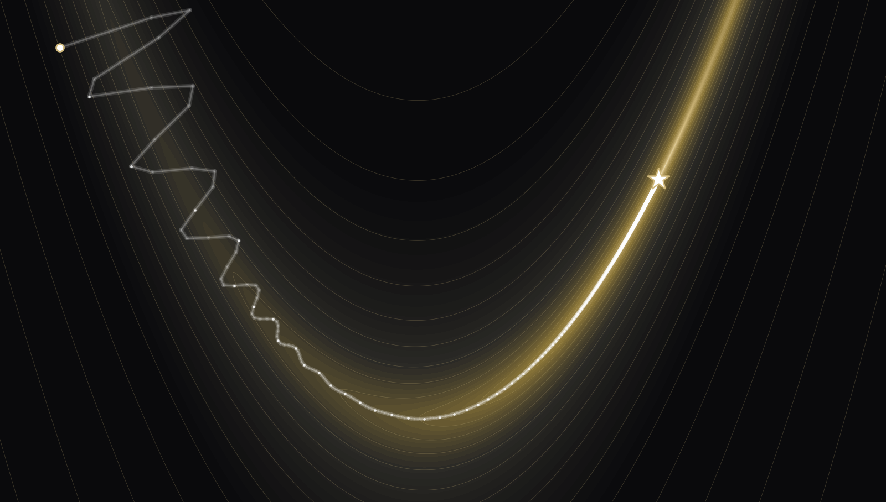

# ASEN 3502: Aerospace Computational Methods

{: .cover-image }

Gradient descent with momentum on the Rosenbrock function -- overshooting the
valley walls before converging on the minimum at (1, 1).
{: .cover-caption }

Welcome! Everything for this course lives here. Use the search bar at the top
to find anything quickly.

## Site map


Generated from the same front matter (title, parent, nav_order) and
_config.yml nav_external_links that build the sidebar, so it cannot drift.
Top level only.


<ul>


<li><a href="{{ p.url | relative_url }}">{{ p.title }}</a></li>


<li><a href="{{ l.url }}">{{ l.title }}</a></li>

</ul>
